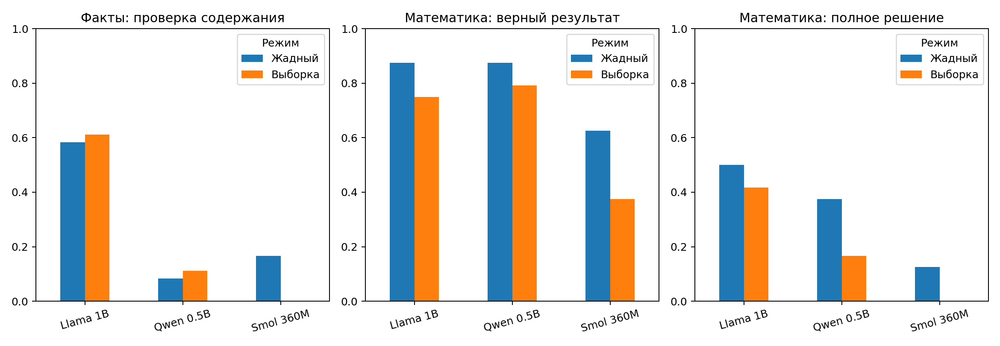
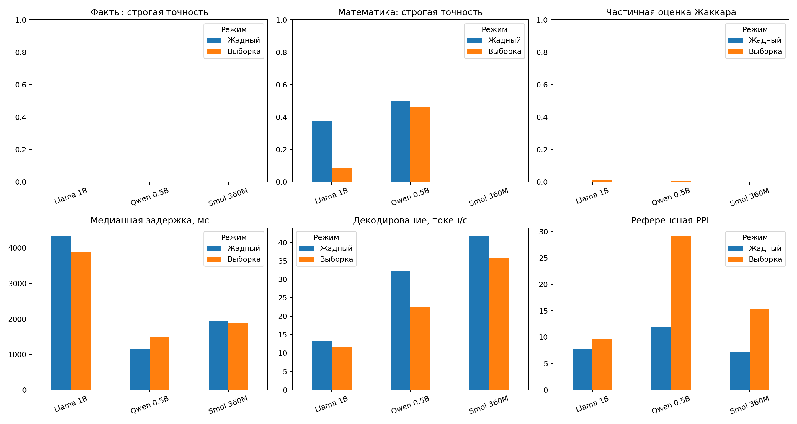

# Цель работы

Цель исследования — воспроизводимо оценить три языковые модели с открытыми весами
на вопросах по истории, румынскому языку и элементарной математике. Раздельно
рассматриваются правильность содержания, соблюдение инструкций, эффективность
генерации и потребление ресурсов. Проверяется, улучшает ли изменение способа
декодирования ответы и оправдывает ли более крупная модель дополнительные ресурсы
в выбранном образовательном сценарии.

Задание требует запустить 3–5 моделей, подготовить 20 вопросов с эталонами,
оценить фактическую правильность, математические решения по шагам, задержку,
скорость, перплексию и ресурсы/стоимость. Для локального выполнения выбран
llama.cpp: он предоставляет доступ к сгенерированным токенам и логитам и является
альтернативой Ollama и LM Studio. Числа из демонстрационного примера PDF не
используются в качестве результатов собственного эксперимента.

Отчёт, авторские комментарии, подписи графиков и пояснения написаны на русском.
Сам эксперимент проведён на румынском языке. Исходные вопросы, системная инструкция
и ответы моделей сохранены как экспериментальные данные; русские переводы вопросов
приведены отдельно и не подменяют входы измеренного запуска.

# Теоретические основы и исследовательские вопросы

## Авторегрессионное моделирование

Авторегрессионная модель оценивает вероятность следующего токена при заданном
контексте: p(x1,...,xT) представляет собой произведение вероятностей
p(xt | x1,...,x(t−1)). Жадное декодирование выбирает наиболее вероятный токен.
При выборке токен извлекается из распределения, изменённого температурой и
фильтрацией top-p. Вероятный ответ не обязательно фактически верен, а гладкость
текста не гарантирует математической корректности.

Открытые веса означают возможность скачать и использовать параметры на условиях
лицензии. Это не подразумевает полного доступа к обучающим данным или одинаковых
лицензий всех моделей. Qwen2.5 и SmolLM2 распространяются по Apache 2.0; пакет Llama
содержит общественную лицензию Meta и политику использования. Тексты лицензий
сохранены в проекте; сами веса в архив для сдачи не включены.

## Исследовательские вопросы

1. Какая модель лучше отвечает на румынский набор при строгой проверке формата
   и при отдельной проверке содержания?
2. Как меняется результат одной модели при переходе от жадного декодирования
   к выборке с низкой температурой?
3. Подкреплён ли правильный числовой ответ корректными шагами и требуемой проверкой?
4. Как соотносятся правильность, задержка, скорость декодирования и память?
5. Что характеризует перплексия и каковы ограничения сравнения разных токенизаторов?

Изначально не предполагается обязательное преимущество более крупной модели.
Семейства различаются обучающими данными и токенизаторами; размер не является
единственной изменяющейся переменной. Причинная зависимость точности от числа
параметров данным дизайном не устанавливается.

# Модели, происхождение и среда

| Идентификатор OCI | Модель по метаданным GGUF | Номинальный размер |
|---|---|---:|
| `ai/qwen2.5:0.5B-F16` | Qwen2.5-0.5B-Instruct | 494,03 млн |
| `ai/smollm2:360m-f16` | SmolLM2-360M-Instruct | около 362 млн |
| `ai/llama3.2:1B-F16` | Llama-3.2-1B-Instruct | 1,24 млрд |

Все модели представлены в GGUF F16 без квантования до 4 или 8 бит. F16 прежде
всего описывает хранение матриц весов; отдельные тензоры и внутренние операции
используют точность, заданную вычислительной реализацией. Не утверждается, что
все операции выполняются исключительно в float16. Общий формат уменьшает
смешение эффектов архитектуры и различий квантования.

Прямой доступ к Hugging Face блокировался политикой прокси с HTTP 403. Артефакты
получены из публичной дистрибуции Docker AI через разрешённый Docker Hub с тем же
прокси и проверкой TLS. Контроль доступа не отключался, контейнеры не запускались.
Скрипт `pull_oci.py` проверяет SHA-256 и размер каждого манифеста и файла.
Неизменяемые версии записаны в `data/models_oci.lock.json`; воспроизведение
использует контрольные суммы, а не изменяемый тег `latest`.

Вычисления выполнялись на CPU без GPU. Каждая модель исследовалась в отдельном
процессе: 4 потока для генерации и обработки запроса, контекст 1024, пакет 512,
`logits_all=True`. Аппаратура, версии и длительность приведены в результатах и
манифесте. Компактные модели выбраны для доступного локального выполнения;
выводы не переносятся автоматически на модели 7–8B из примера задания.

# Набор оценки

Набор содержит 20 заданий: 6 по истории, 6 по румынскому языку и 8 по математике.
Вопросы, эталоны, допустимые варианты и эталонные вычисления опубликованы в
приложении и `data/questions.json`. Вспомогательный перевод находится в
`data/questions_ru.json`. Задания определены до запуска и не изменялись для
повышения результата какой-либо модели.

Неоднозначные формулировки учебного примера заменены проверяемыми. Не используется
спорное прозвище «Lupul». Вопрос о Версальском договоре явно относится к Германии
и дате 28 июня 1919 года, а не ко всем мирным соглашениям после Первой мировой
войны. Наречное значение «frumos» проверяется в конкретном предложении
«El cântă frumos». Для «elevilor» явно запрошена форма с определённым артиклем.

Фактологические эталоны сопровождаются библиографическими ориентирами. Это не
означает, что все внешние страницы удалось открыть в ограниченной среде.
Математические эталоны проверены точной арифметикой и подстановкой. Корпус для
перплексии — фиксированный румынский текст, составленный для работы. Он отделён
от запросов, но тематически с ними пересекается и не является внешним корпусом
для независимой оценки обобщения.

Выборка небольшая, учебная и удобная, а не репрезентативная. Простые известные
факты могли присутствовать в предобучении. Набор не представляет распределение
всех задач на румынском языке; результаты являются исследованием отдельного случая.

# Экспериментальный дизайн

Объём измерений: 3 модели × 20 вопросов × 2 режима × 3 повтора = **360 ответов**.
Сравниваются два режима:

- **Жадный (greedy):** температура 0, без случайной выборки, штраф повторения 1,0.
- **Выборка (sampled):** температура 0,2, top-p 0,9, штраф повторения 1,1;
  top-k и min-p отключены, чтобы исключить дополнительные скрытые фильтры.

Дообучения и обновления весов нет. Одновременно изменяются несколько параметров
декодирования, поэтому отдельный эффект температуры не изолирован. Термин
«tuned» из учебного примера не используется в смысле обучения модели.

Содержание системной инструкции одинаково: ответ на румынском, итоговый маркер
и шаги для математики. Каждая модель использует собственный шаблон диалога из
GGUF с одинаковыми ролями system/user. Запросы не содержат эталонных ответов.
Каждый запрос имеет отдельный контекст без истории диалога и примеров решения.

Начальные значения генератора: 20261030, 20261031 и 20261032. Внутри блока модели
порядок вопросов, режимов и повторов детерминированно перемешан. Два прогревочных
запроса на модель исключены из статистики. Перед каждым измерением очищается
кеш префикса, чтобы повторное использование инструкции не давало разного
преимущества моделям. Предел — 160 новых токенов. Завершение EOS/EOG различается
с остановкой по длине; оборванные ответы остаются в знаменателе.

Порядок моделей фиксирован. Колебания общей облачной инфраструктуры могут влиять
на задержки. Повторы жадного режима характеризуют стабильность и время выполнения,
но не увеличивают число независимых вопросов.

# Метрики и проверка ответов

## Фактическая правильность и формат

Строгая точная оценка равна 1, если текст после последнего маркера `RĂSPUNS FINAL:`
после нормализации совпадает с допустимым эталоном. Нормализация игнорирует регистр,
диакритику и пунктуацию, сохраняя порядок и повторяемость слов. Если маркера нет,
строгая оценка равна 0; это отдельно рассматривается как нарушение формата.

Частичная лексическая оценка Жаккара равна |A∩B|/|A∪B| для множеств слов; выбирается
максимум по допустимым эталонам. Это не семантическая метрика. Например,
«nu 1859» («не 1859») лексически пересекается с «1859», хотя ответ неверен.
Жаккар не используется как доказательство фактической правильности.

Проверка содержания — отдельный анализ чувствительности: верная информация может
быть дана без нужного маркера. Сохраняются исходная строгая оценка и заключение
проверки с пояснением. Автоматический оценщик не подгоняется задним числом под
наблюдаемые формулировки. Для положительного заключения нужен однозначный ответ;
упоминания эталона среди противоречащих вариантов недостаточно. Явный итог имеет
приоритет над промежуточным результатом. Без итога принимается явное присвоение
значения требуемой операции. Неоднозначные случаи консервативно получают 0 с
объяснением решения.

## Математика по шагам

Строгий числовой оценщик извлекает только значение после маркера и допускает целые
числа, десятичные дроби, обыкновенные дроби и запись `x = 6`. Эвристика «последнее
число в тексте» не используется. Сравнение выполняется точными рациональными
дробями; неоднозначное «6 или 7» автоматически не засчитывается.

Числовые равенства на отдельных строках проверяются ограниченным синтаксическим
деревом AST без `eval` и исполнения кода из ответа. Наличие подписи «Шаг 1»
не доказывает правильность рассуждения. Символьные преобразования и объяснения
естественным языком рассматриваются в документированной проверке.

Разделяются три бинарные переменные: **правильный результат**, **верные шаги**
и **полное решение**. Для верных шагов нужна хотя бы одна содержательная,
относящаяся к задаче и корректная трансформация или проверка без математических
противоречий. Равенство, которое лишь приписывает готовый ответ исходной операции,
не считается промежуточным вычислением. При отсутствии шагов их оценка равна 0.
Полнота требует всех запрошенных действий и проверки; для уравнений — подстановки
в исходное равенство. Правильное число без объяснения не является полным решением.

Проведена одна качественная проверка ИИ-ассистентом без независимого второго
оценщика-человека. Коэффициент согласия оценщиков не заявляется. Каждое заключение
связано с хешем полного ответа, поэтому его можно пересмотреть.

## Задержка, скорость, память и стоимость

TTFT — время от начала генерации до выбора первого токена. Оно включает обработку
входа и накладные расходы реализации, но исключает предварительное оформление и
токенизацию запроса. Используется монотонный таймер `perf_counter`. Скорость
декодирования равна (N−1)/(t_последний−t_первый), а сквозная скорость — N/время_всего.
Конечный EOG учитывается в количестве выбранных токенов, но не в сохранённом тексте.
Для единственного токена скорость декодирования не определена.

Приводятся медиана и 95-й процентиль задержки, число токенов и доля обрывов.
Токены в секунду зависят от токенизатора и не равны объёму полезного текста.
Инициализация измеряется отдельно от прогретых запросов: она включает проверку
SHA-256, но не скачивание. Сохранение логитов для всех токенов входит в общую
конфигурацию и может замедлять генерацию относительно сервера, оптимизированного
исключительно для выдачи текста.

Пиковая RSS опрашивается каждые 50 мс в отдельном процессе модели, включая
отображённые веса и буферы. Это наблюдаемый максимум, а не гарантированный абсолютный
пик и не память всей машины. Платы API за локальные запросы нет. Это не означает
нулевой стоимости инфраструктуры и энергии: без тарифа или измерения она неизвестна.
Денежная стоимость задаётся функцией реального почасового тарифа.

## Перплексия

На общем корпусе вычисляются NLL = сумма −ln p(xt|контекст), t=2,...,T,
и PPL = exp(NLL/(T−1)). BOS/EOS не добавляются, первый токен не оценивается.
Размер окна — 512 токенов, шаг — 256. Перекрывающиеся окна устроены так, что
каждый целевой токен учитывается ровно один раз. Численно устойчивый log-sum-exp
вычисляется прямо из логитов до температурных преобразований и штрафов.

Собственная PPL зависит от токенизации, поэтому нельзя наивно ранжировать модели
с разными словарями. Дополнительно вычисляются биты на байт:
NLL/(ln 2 × число байтов UTF-8). Первый токен исключён, но используется полная
длина в байтах; на коротком корпусе сохраняется краевой эффект. Это диагностический
показатель, а не эквивалент семантического качества.

На сгенерированных ответах считается **референсная PPL** одной фиксированной
Qwen2.5-0.5B-Instruct. Взвешенная агрегация равна exp(сумма NLL/сумма целевых
токенов), а не среднему арифметическому PPL отдельных ответов. Референсная модель
может предпочитать собственный стиль; показатель зависит от языка, длины,
повторов и формата. Малая PPL не доказывает истинность или логическую связность.
Это не псевдоперплексия маскированной модели: все участники авторегрессионные.

# Статистический анализ

Независимая единица — вопрос, а не каждый его повтор. 95-процентные интервалы
Уилсона относятся к первому повтору: 12 фактологических и 8 математических вопросов,
либо 6/6/8 при разбиении по категориям. Среднее по трём повторам описывает выбранные
начальные значения генератора, но не превращает n в 36 или 24.

Разности между моделями и режимами оцениваются парным бутстрепом по вопросам с
10 000 перевыборок. Все повторы одного задания остаются в одной группе.
Сравнения разведочные и условны относительно этого небольшого набора. Не заявляется
популяционная репрезентативность или подтверждающая значимость после множественного
выбора сравнений. Вместе с оценками приводятся интервалы и знаменатели.

Проценты, миллисекунды и PPL не складываются в произвольный общий балл. Практический
выбор основан на компромиссе правильности и ресурсов с приоритетом правильности в
образовательном сценарии. Небольшие разности интерпретируются осторожно, особенно
при n=20.

# Проверка реализации

Успешно выполнены **29 программных тестов**; машинный протокол находится в
`reports/tests.xml`. Проверяются диакритика, допустимые варианты, отрицание,
отказ угадывать произвольное число, дроби, истинные и ложные равенства, небезопасные
выражения, однократный учёт токенов в окнах и отказ применять заключение к другому
хешу ответа. Уменьшенная GPT-2 с нулевыми весами и словарём 16 должна давать PPL=16;
имитированный адаптер отдельно проверяет ту же формулу пути GGUF. Синтетические
данные используются только для проверки программы и не входят в результаты моделей.

Агрегация проверена на явно помеченной синтетической выборке. Неудачный запуск
не может породить итоговый рейтинг. `pip check` не выявил несовместимых зависимостей.
До эксперимента проверены реальная генерация и правдоподобие короткого текста;
эти пробные запросы не входят в 360 наблюдений. Все 13 программных ячеек итогового
блокнота выполнены на реальных приложениях, включая проверку полноты, хешей и оценок.

Регрессионная проверка эмулирует системную кодировку Windows-1251: воспроизводит
исходную ошибку чтения без UTF-8, затем проверяет загрузку ячейки набора и
чтение/запись всей цепочки оценивания без изменения Unicode-текстов.

# Экспериментальные результаты

Получены и сохранены **360 реальных ответов**, по 120 на модель. Проверены все 360 ответов (166 уникальных сочетаний модели, задания и текста). Синтетические ответы в результаты эксперимента не включены.

| Параметр | Значение |
|---|---|
| Реализация | llama-cpp-python 0.3.16 |
| Python | 3.12.14 |
| Процессор | AMD EPYC 9V74 80-Core Processor |
| Квота CPU (cpu.max) | 400000 100000 |
| Потоков | 4 |
| Доступная память | 33.29 ГиБ |
| Контекст / пакет | 1024 / 512; logits_all=True; без GPU |
| Начало, Кишинёв | 30.10.2026 16:53:37 EET |
| Окончание, Кишинёв | 30.10.2026 17:17:51 EET |
| Сумма времени запросов | 1120.95 с |
| Полный период | 1454.0 с, включая диагностику и возобновление |

После первого блока обнаружен пакет базовой SmolLM2 без шаблона диалога. До измерений SmolLM2 он заменён на Instruct. Готовый блок Qwen использован повторно после проверки набора, настроек и контрольной суммы. Манифест первой попытки сохранён; полный период включает диагностическую паузу.

## Строгая правильность и проверка содержания

| Модель | Режим | Факты: строго | Факты: проверка | Мат.: строго | Мат.: проверка |
|---|---|---|---|---|---|
| Llama 1B | Жадный | 0.0% | 58.3% | 37.5% | 87.5% |
| Llama 1B | Выборка | 0.0% | 61.1% | 8.3% | 75.0% |
| Qwen 0,5B | Жадный | 0.0% | 8.3% | 50.0% | 87.5% |
| Qwen 0,5B | Выборка | 0.0% | 11.1% | 45.8% | 79.2% |
| Smol 360M | Жадный | 0.0% | 16.7% | 0.0% | 62.5% |
| Smol 360M | Выборка | 0.0% | 0.0% | 0.0% | 37.5% |

Среднее по начальным значениям использует 36 фактологических и 24 математических ответа на сочетание модели и режима. Независимых вопросов по-прежнему 12 и 8. Разрыв между строгой оценкой и проверкой содержания показывает влияние формата.

### Разбиение по предметным областям

| Модель | Режим | История | Румынский язык | Математика |
|---|---|---|---|---|
| Llama 1B | Жадный | 66.7% | 50.0% | 87.5% |
| Llama 1B | Выборка | 77.8% | 44.4% | 75.0% |
| Qwen 0,5B | Жадный | 16.7% | 0.0% | 87.5% |
| Qwen 0,5B | Выборка | 16.7% | 5.6% | 79.2% |
| Smol 360M | Жадный | 16.7% | 16.7% | 62.5% |
| Smol 360M | Выборка | 0.0% | 0.0% | 37.5% |

### Интервалы Уилсона по первому повтору

| Модель | Режим | Факты: k/n, ДИ 95% | Математика: k/n, ДИ 95% |
|---|---|---|---|
| Llama 1B | Жадный | 7/12 [32.0; 80.7] | 7/8 [52.9; 97.8] |
| Llama 1B | Выборка | 7/12 [32.0; 80.7] | 6/8 [40.9; 92.9] |
| Qwen 0,5B | Жадный | 1/12 [1.5; 35.4] | 7/8 [52.9; 97.8] |
| Qwen 0,5B | Выборка | 1/12 [1.5; 35.4] | 8/8 [67.6; 100.0] |
| Smol 360M | Жадный | 2/12 [4.7; 44.8] | 5/8 [30.6; 86.3] |
| Smol 360M | Выборка | 0/12 [0.0; 24.2] | 2/8 [7.1; 59.1] |

Интервалы относятся к повтору 0, а не к среднему по трём повторам.

## Математика: верные шаги и полные решения

| Модель | Режим | Верный результат | Верные шаги | Полное решение |
|---|---|---|---|---|
| Llama 1B | Жадный | 87.5% | 62.5% | 50.0% |
| Llama 1B | Выборка | 75.0% | 45.8% | 41.7% |
| Qwen 0,5B | Жадный | 87.5% | 37.5% | 37.5% |
| Qwen 0,5B | Выборка | 79.2% | 16.7% | 16.7% |
| Smol 360M | Жадный | 62.5% | 12.5% | 12.5% |
| Smol 360M | Выборка | 37.5% | 0.0% | 0.0% |

Все 144 математических ответа проверены; пояснения и хеши приведены в `manual_review_ru.csv`. Оценка шагов не выводится из одного присутствия слова «шаг».

{width=100%}

## Задержка и скорость

| Модель | Режим | TTFT, мс | Задержка, мс | P95, мс | Токен/с | Обрывы |
|---|---|---|---|---|---|---|
| Llama 1B | Жадный | 1518.1 | 4348.5 | 13315.4 | 13.36 | 10.0% |
| Llama 1B | Выборка | 1508.2 | 3879.1 | 13398.9 | 11.68 | 3.3% |
| Qwen 0,5B | Жадный | 580.3 | 1149.7 | 4959.1 | 32.19 | 10.0% |
| Qwen 0,5B | Выборка | 586.3 | 1482.5 | 3201.0 | 22.57 | 0.0% |
| Smol 360M | Жадный | 537.5 | 1931.2 | 4613.7 | 41.85 | 35.0% |
| Smol 360M | Выборка | 545.8 | 1886.6 | 5054.8 | 35.74 | 13.3% |

TTFT, задержка и токены/с представлены медианами; P95 — 95-й процентиль задержки. Прогрев исключён. Скорость рассматривается совместно с длиной и правильностью ответов.

{width=100%}

## Перплексия

| Модель | Целевых токенов | Собственная PPL | Бит/байт |
|---|---|---|---|
| Qwen 0,5B | 264 | 11.046 | 1.355 |
| Smol 360M | 309 | 14.173 | 1.751 |
| Llama 1B | 258 | 8.066 | 1.151 |

| Модель | Режим | Взвешенная референсная PPL |
|---|---|---|
| Llama 1B | Жадный | 7.826 |
| Llama 1B | Выборка | 9.542 |
| Qwen 0,5B | Жадный | 11.887 |
| Qwen 0,5B | Выборка | 29.241 |
| Smol 360M | Жадный | 7.098 |
| Smol 360M | Выборка | 15.290 |

Разное число целевых токенов на одном тексте отражает влияние токенизации. Референсная PPL использует Qwen и включает маркеры и шаги. Малая величина не доказывает правильность и не служит основанием выбора победителя.

## Ресурсы и стоимость

| Модель | Веса, ГиБ | RSS, ГиБ | Запуск, с | CPU генерации, с |
|---|---|---|---|---|
| Qwen 0,5B | 0.926 | 1.498 | 0.966 | 801.43 |
| Smol 360M | 0.676 | 0.963 | 0.613 | 1180.12 |
| Llama 1B | 2.309 | 2.840 | 2.360 | 2415.11 |

Сумма астрономического времени 360 запросов — 1120.95 с. При условном тарифе r денежных единиц в час только эти измеренные запросы соответствуют коэффициенту 0.311375 × r. Это не счёт за инфраструктуру: запуск, PPL, хранение и остальное резервирование добавляются по реальным правилам оплаты. Плата API за токены при локальном запуске равна 0; облачный тариф и энергопотребление не предоставлены и не измерены.

## Парные сравнения

| Режим | A − B | Разность, п.п. | ДИ 95%, п.п. |
|---|---|---|---|
| Жадный | Llama 1B − Qwen 0,5B | 30.00 | [5.0; 55.0] |
| Жадный | Llama 1B − Smol 360M | 35.00 | [5.0; 60.0] |
| Жадный | Qwen 0,5B − Smol 360M | 5.00 | [-20.0; 30.0] |
| Выборка | Llama 1B − Qwen 0,5B | 28.33 | [5.0; 50.0] |
| Выборка | Llama 1B − Smol 360M | 51.67 | [26.7; 73.3] |
| Выборка | Qwen 0,5B − Smol 360M | 23.33 | [10.0; 38.3] |

Метрика — правильность содержания на 20 вопросах с группировкой повторов. П.п. — процентные пункты. Интервалы разведочные, без поправки на множественные сравнения.

| Модель | Жадный: содержание | Выборка: содержание | Разность, п.п. | ДИ 95%, п.п. |
|---|---|---|---|---|
| Qwen 0,5B | 40.0% | 38.3% | -1.67 | [-10.0; 6.7] |
| Smol 360M | 35.0% | 15.0% | -20.00 | [-36.7; -5.0] |
| Llama 1B | 70.0% | 66.7% | -3.33 | [-18.3; 10.0] |

Каждый вопрос имеет одинаковый вес: 60 ответов на модель и режим. Эффект температуры не отделён от top-p и штрафа повторения.

## Примеры ошибок и чувствительность оценщика

Ниже приведены русские переводы фрагментов для чтения; исходные ответы с теми же числовыми утверждениями и хешами сохранены в данных.

### Qwen 0,5B, задание 1, Жадный, повтор 0

```text
Объединение румынских княжеств произошло в 1918 году.
```

Год указан неверно: эталон — 1859.

### Qwen 0,5B, задание 18, Выборка, повтор 1

```text
Ответ: 1

Проверка:
3(1) - 4 = 2
3 - 4 = 2
-1 = 2 (семь)

Решение: x = 1.
```

Предложено x=1 и заявлено ложное равенство -1=2.

### Qwen 0,5B, задание 20, Жадный, повтор 0

```text
ИТОГОВЫЙ ОТВЕТ: 7² + 5² = 49 + 25 = 74
```

Цепочка 7²+5²=49+25=74 верна и достаточна; строгий извлекатель не принимает выражение вместо отдельного значения.

### Llama 1B, задание 13, Жадный, повтор 0

```text
245 + 378 = 623

Промежуточные вычисления:
1. 245 + 200 = 445
2. 445 + 78 = 523
3. 523 + 56 = 579

Итоговый ответ: 579
```

Итог неверен: 579/523/378/323. Число 378 разложено неправильно; в жадном режиме начальное упоминание 623 не отменяет явный итог 579.

# Обсуждение и выводы по измерениям

## Правильность и условная рекомендация

На выбранном наборе **Llama-3.2-1B в жадном режиме** показывает лучшую общую
правильность содержания: **70,0%** против 40,0% у Qwen и 35,0% у SmolLM2.
Преимущество прежде всего фактологическое: 58,3% у Llama, 8,3% у Qwen и 16,7%
у SmolLM2. В истории жадная Llama правильно отвечает на 4 из 6 вопросов, в
румынском языке — на 3 из 6. Даже этого недостаточно для образовательного
использования без проверки.

По числовому математическому результату **жадные Llama и Qwen равны: 87,5%**,
то есть 7/8 вопросов с тем же результатом в трёх повторах. Единственного победителя
здесь нет. Полнота отличается: у Llama 50,0% полных решений, у Qwen 37,5%,
у SmolLM2 12,5%. Точность 87,5% не означает, что столько же доказательств верны
и полны. Для 7/8 интервал Уилсона по первому повтору составляет примерно
[52,9%; 97,8%], что подчёркивает высокую неопределённость.

Строгая фактологическая оценка во всех конфигурациях равна 0%. Это не доказывает
отсутствия знаний: многие правильные ответы не имеют маркера или не совпадают
с конечным списком допустимых форм. Например, Llama называет Кузу без маркера,
а форма «Ștefan III de Moldavia» при проверке распознаётся как Штефан Великий.
Разделение формата и содержания существенно меняет интерпретацию автоматики.

В разведочном сравнении жадных режимов разность Llama–Qwen равна +30 п.п.
с бутстреп-интервалом [5; 55] п.п.; Llama–SmolLM2 — +35 п.п. с [5; 60] п.п.
Интервал Qwen–SmolLM2, [-20; 30] п.п., включает 0. Выводы условны относительно
20 заданий и единственной качественной проверки. Это не подтверждающий тест
с поправкой на множественные сравнения и не универсальное превосходство семейства.

## Политика декодирования

Выборка не повысила среднюю правильность этого эксперимента: Llama снизилась с
70,0% до 66,7%, Qwen — с 40,0% до 38,3%, SmolLM2 — с 35,0% до 15,0%.
Интервалы разности «выборка минус жадный режим» включают 0 у Llama и Qwen;
доказательств устойчивого эффекта для них недостаточно. У SmolLM2 разведочный
интервал равен [-36,7; -5,0] п.п. Наблюдается ухудшение на наборе, но его нельзя
приписать только температуре: одновременно изменены top-p и штраф повторения.

## Скорость и память

**Жадная SmolLM2** имеет наибольшую медианную скорость декодирования — около
**41,85 токена/с**. У жадной Qwen — 32,19, у жадной Llama — 13,36.
Однако медианная задержка меньше у Qwen: около 1,15 с против 1,93 с у SmolLM2.
Ответы имеют разную длину, а SmolLM2 выдаёт больше повторяющегося текста.
Пропускная способность декодирования и время полного ответа не взаимозаменяемы.

SmolLM2 также показывает минимальную наблюдаемую пиковую RSS: около 0,96 ГиБ,
против 1,50 ГиБ у Qwen и 2,84 ГиБ у Llama. При этом доля обрывов жадной SmolLM2
равна 35%, а общая правильность — только 35%. Экономия ресурсов сама по себе
не компенсирует низкую полезность ответов. Qwen быстрее справляется с простой
арифметикой этого набора, но слабо отвечает на фактологические вопросы на румынском.

Если приоритетом является содержание и доступны примерно 3 ГиБ для измеренного
процесса, условный выбор по этим данным — **жадная Llama**. Если нужны только простые
числовые вычисления при меньшей памяти, жадная Qwen достигает той же точности
результата быстрее, однако её шаги необходимо проверять. Ни одну из моделей
нельзя рекомендовать как единственного авторитетного оценщика студенческих работ.

## Перплексия и ошибки рассуждения

Референсная PPL жадной SmolLM2 составляет около 7,10 — меньше, чем 7,83 у Llama,
при общей правильности 35% против 70%. Повторяющийся предсказуемый текст способен
получать низкую PPL; это конкретный пример того, что показатель не удостоверяет
истинность. На общем корпусе собственная PPL равна 8,07 у Llama, 11,05 у Qwen
и 14,17 у SmolLM2, но разные токенизаторы мешают наивному ранжированию. Для
интерпретации нужны биты на байт и условия контекста; сам корпус остаётся коротким.

Проверка выявляет как численно ложные равенства — Qwen утверждает −1=2, — так и
рассуждения с верными отдельными равенствами, но неправильным разложением.
Llama начинает 245+378 с правильного 623, затем прибавляет 200, 78 и 56 и объявляет
финальным ответом 579. Сумма прибавлений равна 334, а не 378. Проверка только
каждого равенства или извлечение первого правильного числа пропустили бы логику ошибки.

## Итоговый вывод

Выполнена фактическая, математическая и ресурсная оценка трёх локально запущенных
моделей с измерением эффективности и перплексии. Основной результат — прослеживаемая
методика, где итоговый ответ, формат, шаги и стоимость являются разными переменными.
Измерения поддерживают условное предпочтение жадной Llama в смешанном сценарии,
не обосновывая перенос вывода на другие наборы, крупные модели или другую аппаратуру.


# Ограничения и угрозы валидности

- **Малая выборка:** простые задания не охватывают сложные доказательства,
  длинные тексты и всё многообразие грамматики.
- **Возможное пересечение с обучением:** известные факты могли быть запомнены.
- **Формат и знание:** строгая оценка штрафует нарушение инструкции; проверка
  содержания нужна, чтобы отличать его от отсутствия знания.
- **Один проверяющий:** качественные решения не проходили независимую оценку.
- **Компактные модели и фиксированный порядок:** выводы не распространяются на
  большие модели или GPU, а общая инфраструктура может влиять на задержку.
- **Запрос и декодирование:** другая инструкция или граница длины способны изменить
  результат; режимы различаются сразу несколькими параметрами.
- **Перплексия:** короткий тематически близкий корпус, токенизатор и референсная
  модель вносят смещения; PPL не проверяет фактическую истинность.
- **Стоимость:** фактический облачный тариф и энерготелеметрия отсутствуют;
  полная денежная стоимость и выбросы произвольно не оцениваются.

Расширение исследования требует более крупного набора, стратифицированного по
сложности, независимого внешнего румынского корпуса, нескольких порядков моделей,
большего числа начальных значений и двух независимых оценщиков. Эти расширения
не выдаются за выполненную часть данной работы.

# Литература и источники

1. Задание лабораторной: *LL1. Evaluare modele LLM-1 (2).pdf*, предоставленный документ.
2. Docker. Документация Model Runner. https://docs.docker.com/ai/model-runner/
3. Docker AI. Пакеты `ai/qwen2.5`, `ai/smollm2`, `ai/llama3.2`; скачанные манифесты,
   конфигурации и лицензии сохранены в цифровых приложениях.
4. llama.cpp / llama-cpp-python. https://github.com/abetlen/llama-cpp-python
5. Hugging Face. Перплексия моделей с фиксированной длиной контекста.
   https://huggingface.co/docs/transformers/perplexity
6. Qwen Team. Qwen2.5-0.5B-Instruct. https://huggingface.co/Qwen/Qwen2.5-0.5B-Instruct
7. Hugging Face. SmolLM2-360M-Instruct. https://huggingface.co/HuggingFaceTB/SmolLM2-360M-Instruct
8. Meta. Llama-3.2-1B-Instruct. https://huggingface.co/meta-llama/Llama-3.2-1B-Instruct
9. Академия Румынии. *DOOM*, 3-е изд., 2021; *Gramatica limbii române*, т. I, 2005.
10. Wilson, E. B. (1927). Probable inference, the law of succession, and statistical
    inference. *JASA*, 22(158), 209–212. doi:10.1080/01621459.1927.10502953.
11. Efron, B., Tibshirani, R. J. (1993). *An Introduction to the Bootstrap*. Chapman & Hall.

Ссылки указывают происхождение дистрибуций и методики. Успешный сетевой доступ
подтверждается только для действительно скачанных и сохранённых с контрольными
суммами артефактов. Официальные названия источников и цитируемые данные могут
содержать исходный язык.

# Приложение А. Вопросы и эталоны

Ниже дан вспомогательный русский перевод. При измерении модели получали румынские оригиналы из `data/questions.json`. Перевод не использовался для повторного расчёта вероятностей или оценок.

## Задание 1 — История

В каком году произошло Объединение румынских княжеств, известное как Малое объединение?

Эталон: 1859.

Источник: https://www.britannica.com/place/Romania/Unification-of-Moldavia-and-Walachia

## Задание 2 — История

Кто в 1859 году был избран господарем и Молдавии, и Валахии?

Эталон: Александру Иоан Куза.

Источник: https://www.britannica.com/biography/Alexandru-Ioan-Cuza

## Задание 3 — История

В каком году 1 декабря в Алба-Юлии была принята резолюция об объединении Трансильвании с Румынией?

Эталон: 1918.

Источник: https://www.britannica.com/place/Romania/Greater-Romania

## Задание 4 — История

Какова столица Республики Молдова?

Эталон: Кишинёв (Chișinău).

Источник: https://www.britannica.com/place/Chisinau

## Задание 5 — История

Как называется мирный договор, подписанный 28 июня 1919 года между Германией и союзными державами?

Эталон: Версальский договор.

Источник: https://www.britannica.com/event/Treaty-of-Versailles-1919

## Задание 6 — История

Какой господарь Молдавии победил в битве при Васлуе в 1475 году?

Эталон: Штефан Великий.

Источник: https://www.britannica.com/biography/Stephen-prince-of-Moldavia

## Задание 7 — Румынский язык

Какова форма множественного числа румынского существительного «cafea»?

Эталон: cafele.

Источник: DOOM3 (2021), статья cafea; https://doom.lingv.ro/

## Задание 8 — Румынский язык

Выберите синоним румынского слова «rapid»: «iute» или «greoi».

Эталон: iute.

Источник: DEX, статья rapid; https://dexonline.ro/definitie/rapid

## Задание 9 — Румынский язык

Выберите правильную румынскую форму: «ar trebui să vii» или «ar trebui să vi».

Эталон: ar trebui să vii.

Источник: DOOM3 (2021), статья veni; https://doom.lingv.ro/

## Задание 10 — Румынский язык

Какой частью речи является «frumos» в румынском предложении «El cântă frumos»?

Эталон: Наречие (adverb).

Источник: Gramatica limbii române, Academia Română (2005), vol. I, Adverbul

## Задание 11 — Румынский язык

Выберите антоним румынского слова «adevăr»: «minciună» или «certitudine».

Эталон: minciună.

Источник: DEX, статьи adevăr și minciună; https://dexonline.ro/definitie/minciun%C4%83

## Задание 12 — Румынский язык

Какова форма родительного-дательного падежа множественного числа с определённым артиклем у румынского существительного «elev»?

Эталон: elevilor.

Источник: DOOM3 (2021), статья elev; https://doom.lingv.ro/

## Задание 13 — Математика

Вычислите 245 + 378. Покажите промежуточные вычисления.

Эталон: 623.

Эталонные вычисления:

- `245 + 300 = 545`
- `545 + 78 = 623`

## Задание 14 — Математика

Вычислите 1000 − 457. Покажите промежуточные вычисления.

Эталон: 543.

Эталонные вычисления:

- `1000 - 400 = 600`
- `600 - 57 = 543`

## Задание 15 — Математика

Вычислите 36 × 12. Покажите промежуточные вычисления.

Эталон: 432.

Эталонные вычисления:

- `36 * 10 = 360`
- `36 * 2 = 72`
- `360 + 72 = 432`

## Задание 16 — Математика

Вычислите 560 ÷ 8. Покажите проверку умножением.

Эталон: 70.

Эталонные вычисления:

- `560 / 8 = 70`
- `70 * 8 = 560`

## Задание 17 — Математика

Решите уравнение 2x + 5 = 17 и проверьте решение подстановкой.

Эталон: 6.

Эталонные вычисления:

- `17 - 5 = 12`
- `12 / 2 = 6`
- `2 * 6 + 5 = 17`

## Задание 18 — Математика

Решите уравнение 3x − 4 = 2 и проверьте решение подстановкой.

Эталон: 2.

Эталонные вычисления:

- `2 + 4 = 6`
- `6 / 3 = 2`
- `3 * 2 - 4 = 2`

## Задание 19 — Математика

Вычислите (15 + 5) × (10 − 7). Покажите промежуточные вычисления.

Эталон: 60.

Эталонные вычисления:

- `15 + 5 = 20`
- `10 - 7 = 3`
- `20 * 3 = 60`

## Задание 20 — Математика

Вычислите 7² + 5². Покажите промежуточные вычисления.

Эталон: 74.

Эталонные вычисления:

- `7 ** 2 = 49`
- `5 ** 2 = 25`
- `49 + 25 = 74`

# Приложение Б. Воспроизводимость

SHA-256 исходного набора: `cad9356f3f0165250392923b5039037ef0c93cd2e178a66e0e75eba2b23b2af4`

SHA-256 корпуса: `ce7324173ec90acd9faca3c4d42321a55e1906d53d82f594816e26eea39ce2dd`

**ai/qwen2.5:0.5B-F16**

Манифест: `sha256:3e1aad67b4cc8e3dca660fe65f9f73edb598474284256ffdd9ba460b5b35ff26`

GGUF: `sha256:f1ad9d1174ce6ab47b584d522634c47e411b75bffdffd9a4e106e21e882392e5`

**ai/smollm2:360m-f16**

Манифест: `sha256:5f2b4fbe1650dabbeb1d7c86750d20267614f1715e09ede366053a7f8984c2e7`

GGUF: `sha256:a41984d8bebc26ee81daf68d15077ad86aac2894ee5e9d3453b6895060df213e`

**ai/llama3.2:1B-F16**

Манифест: `sha256:158533c5c78e4d5ddcc9251691e91fdab10031e4da28148c788f44c52af6dd5b`

GGUF: `sha256:1f33ad43d2b85b908ff06fe7002b69806a57359b9b2617ca27d7bdea428ae146`

Команды выполняются из корня проекта:

```bash
bash install.sh
.venv/bin/python src/pull_oci.py --locked data/models_oci.lock.json
.venv/bin/python src/benchmark_gguf.py --run-id replicare-01
.venv/bin/python src/analyze.py results/runs/replicare-01
```

Если новые ответы отличаются, требуется новая проверка. Существующее заключение принимается только для той же модели, задания и хеша текста. Для сохранённых итоговых результатов:

```bash
.venv/bin/python src/audit.py results/final data/review_decisions.json
.venv/bin/python src/analyze.py results/final
.venv/bin/python src/build_report.py --run results/final
```

Цифровые приложения содержат все ответы, пояснения проверки, ресурсы, таблицы CSV/JSON, интервалы бутстрепа, графики, выполненный блокнот и протокол тестов. Читаемые таблицы с суффиксом `_ru` оформлены по-русски; машинные идентификаторы исходной схемы сохранены. Веса скачиваются отдельно по контрольным суммам.

